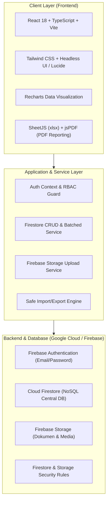

# DOKUMEN ARSITEKTUR SISTEM & DESAIN UI/UX
## KELOMPOK KEBON KOPI — DIGITAL MANAGEMENT SYSTEM (KK-DMS)
*Versi: 1.0.0 — Phase 1: Foundation & System Blueprint*

---

## 1. PENDAHULUAN & PRINSIP PENGEMBANGAN

Sistem Informasi dan Manajemen Digital Kelompok Kebon Kopi (**KK-DMS**) dirancang sebagai pusat administrasi, arsip, dan monitoring kegiatan kelompok secara terpusat, modern, dan berkelanjutan. 

### Prinsip Utama Sistem:
1. **Real Production Ready**: Tidak menggunakan mock/localStorage sebagai database permanen. Seluruh persistensi data terhubung ke Google Firebase (Cloud Firestore & Storage).
2. **Progressive / Bertahap**: Arsitektur disiapkan dari awal untuk menerima penambahan data dan fitur tanpa merusak atau merombak database yang sudah ada.
3. **Integritas Data Jamaah**: Sesuai instruksi khusus, data jamaah dibuat ringkas dan terfokus: hanya **Nama** dan **Jenis Kelamin (Laki-laki / Perempuan)** dengan unique auto-generated ID.
4. **Keamanan & Role-Based Access Control (RBAC)**: Pemisahan tegas antara area publik tanpa autentikasi dan area administrasi multi-level (Super Admin, Admin, Pengurus).
5. **Responsif Multi-Device**: Mengutamakan kenyamanan penggunaan di Desktop/Laptop, Tablet, dan Smartphone (Mobile-First responsive data tables & cards).

---

## 2. ARSITEKTUR TEKNOLOGI



---

## 3. ARSITEKTUR DATABASE CLOUD FIRESTORE

### Skema Koleksi Utama

```mermaid
erDiagram
    USERS ||--o{ ACTIVITY_LOGS : creates
    USERS {
        string uid PK
        string email
        string displayName
        string role "super_admin | admin | pengurus"
        string photoURL
        boolean isActive
        timestamp createdAt
        timestamp updatedAt
    }

    JAMAAH ||--o{ ATTENDANCE : records
    JAMAAH {
        string id PK "auto_generated"
        string nama
        string jenisKelamin "Laki-laki | Perempuan"
        boolean isActive
        timestamp createdAt
        timestamp updatedAt
        string createdBy
        string updatedBy
    }

    PENGAJIAN ||--o{ ATTENDANCE : includes
    PENGAJIAN {
        string id PK "auto_generated"
        string namaPengajian
        string tanggal "YYYY-MM-DD"
        string waktu "HH:mm"
        string lokasi
        string deskripsi
        string status "Terjadwal | Selesai | Dibatalkan"
        int totalHadir
        int totalIzin
        int totalSakit
        int totalAlpa
        timestamp createdAt
        string createdBy
    }

    ATTENDANCE {
        string id PK "composite: pengajianId_jamaahId"
        string pengajianId FK
        string jamaahId FK
        string jamaahNama
        string jamaahJenisKelamin
        string status "Hadir | Izin | Sakit | Alpa"
        string keterangan
        timestamp updatedAt
        string updatedBy
    }

    PENEROBOS {
        string id PK "auto_generated"
        string namaAnggota
        string jabatan
        string deskripsiJobdesk
        string tanggungJawab
        string targetPekerjaan
        string status "Belum Dimulai | Sedang Dikerjakan | Selesai | Perlu Evaluasi"
        string catatanEvaluasi
        string dokumenUrl
        timestamp updatedAt
        string createdBy
    }

    MUSYAWARAH {
        string id PK "auto_generated"
        string judulKeputusan
        string deskripsi
        string tanggalMusyawarah
        string penanggungJawab
        string targetPenyelesaian
        int persentaseProgres "0 - 100"
        string status "Belum Dilaksanakan | Sedang Berjalan | Selesai | Tertunda | Tidak Dilanjutkan"
        string catatanPerkembangan
        string buktiDokumenUrl
        timestamp createdAt
        timestamp updatedAt
        string createdBy
    }

    DOCUMENTS {
        string id PK "auto_generated"
        string judul
        string kategori "Organisasi | Penerobos | Musyawarah | Pengajian | Laporan | Lainnya"
        string fileUrl
        string fileName
        int fileSize
        string mimeType
        boolean isPublic
        timestamp uploadedAt
        string uploadedBy
    }

    ACTIVITY_LOGS {
        string id PK "auto_generated"
        string userId
        string userName
        string action
        string module
        string details
        timestamp timestamp
    }
```



### Logika Bisnis & Formula Perhitungan:
1. **Persentase Kehadiran Absensi**:
   $$\text{Persentase Kehadiran} = \frac{\sum \text{Kehadiran (Hadir)}}{\text{Total Kegiatan Aktif yang Diikuti}} \times 100\%$$
   - Jamaah yang tidak hadir dengan status `Izin`, `Sakit`, atau `Alpa` tidak dihitung sebagai hadir.
   - Kegiatan yang dibatalkan dikeluarkan dari penyebut (*denominator*).
   - Jamaah yang baru terdaftar tidak dihitung alpa pada kegiatan sebelum tanggal pendaftarannya.

2. **Ketercapaian Hasil Musyawarah**:
   $$\text{Persentase Ketercapaian} = \frac{\sum \text{Progres Program Aktif}}{\text{Jumlah Program Aktif}}$$
   - Program dengan status `Tidak Dilanjutkan` secara otomatis di-*exclude* dari perhitungan program aktif.

3. **Import Excel Jamaah yang Aman (9-Step Pipeline)**:
   - File Diunggah $\rightarrow$ Parse XLSX/CSV $\rightarrow$ Tampilkan Pratinjau Tabel $\rightarrow$ Validasi Nama & Standarisasi Gender (`Laki-laki` / `Perempuan`) $\rightarrow$ Deteksi Nama Duplikat terhadap DB $\rightarrow$ Konfirmasi Manual Admin $\rightarrow$ Batch Firestore Commit $\rightarrow$ Ringkasan Laporan Hasil Import.

---

## 4. SISTEM IDENTITAS VISUAL & DESAIN UI/UX

### Karakter: "Modern Islamic Community Management System"
Menampilkan kesan yang bersih, elegan, bersahabat, teratur, dan profesional tanpa dekorasi visual yang berlebihan.

### Palet Warna Resmi
| Peran Warna | Kode HEX | Kegunaan |
|---|---|---|
| **Forest Green** | `#174A35` | Warna brand utama, Topbar publik, Sidebar header, tombol primer |
| **Olive Green** | `#668C55` | Warna aksen, badge status aktif, grafik progres |
| **Soft Beige** | `#F2EBDD` | Background kartu sorotan, highlight, aksen hangat |
| **White** | `#FFFFFF` | Permukaan tabel, form input, kartu dashboard |
| **Dark Text** | `#26352C` | Teks utama, heading, kontras tinggi |
| **Light Background** | `#F7F9F6` | Background canvas seluruh aplikasi |

### Tipografi
- **Headings (H1 - H5)**: `Plus Jakarta Sans`, sans-serif (Semi-bold / Bold, modern & rapi).
- **Body & Data Tables**: `Inter`, sans-serif (Sangat mudah dibaca pada angka dan tabel administrasi).

---

## 5. RANCANGAN STRUKTUR FOLDER PROYEK

```text
kelompok-kebon-kopi/
├── public/
│   ├── logo-placeholder.svg      # Placeholder logo siap swap dengan logo resmi
│   ├── favicon.ico
│   └── images/
├── src/
│   ├── assets/                   # Aset grafis & ilustrasi
│   ├── components/
│   │   ├── layout/               # Header, Sidebar, Footer, MobileNav
│   │   ├── navigation/           # Breadcrumb, TabNav, PublicNavbar
│   │   ├── dashboard/            # StatCard, RecentActivityCard, QuickAction
│   │   ├── charts/               # AttendanceChart, ProgressDonut, MonthlyTrend
│   │   ├── tables/               # ResponsiveTable, Pagination, TableFilter
│   │   ├── forms/                # FormInput, Select, ExcelUploader, DatePicker
│   │   └── common/               # Modal, Badge, Button, EmptyState, Toast
│   ├── pages/
│   │   ├── public/
│   │   │   ├── BerandaPage.tsx
│   │   │   ├── ProfilPage.tsx
│   │   │   ├── KegiatanPublikPage.tsx
│   │   │   ├── GaleriPage.tsx
│   │   │   └── KontakPage.tsx
│   │   ├── auth/
│   │   │   └── LoginPage.tsx
│   │   └── dashboard/
│   │       ├── DashboardOverview.tsx
│   │       ├── jamaah/           # JamaahListPage, ImportExcelModal
│   │       ├── attendance/       # JadwalPengajianPage, InputAbsensiPage, RekapAbsensiPage
│   │       ├── penerobos/        # JobdeskListPage, JobdeskDetailPage
│   │       ├── musyawarah/       # MusyawarahListPage, MonitoringProgramPage
│   │       ├── reports/          # LaporanAbsensiPage, LaporanMusyawarahPage, ExportCenterPage
│   │       ├── documents/        # DokumenCenterPage, UploadModal
│   │       └── settings/         # OrganizationSettings, UserRoleManager, BackupInfoPage
│   ├── services/
│   │   ├── firebase.ts           # Inisialisasi Firebase App
│   │   ├── authService.ts        # Login, logout, role check
│   │   ├── jamaahService.ts      # CRUD Jamaah & batch commit
│   │   ├── attendanceService.ts  # Jadwal & kalkulasi absensi
│   │   ├── musyawarahService.ts  # Decision tracking & progress updates
│   │   ├── penerobosService.ts   # Jobdesk management
│   │   ├── exportService.ts      # Engine pembuatan XLSX & PDF
│   │   └── storageService.ts     # Upload file & thumbnailing
│   ├── hooks/
│   │   ├── useAuth.ts
│   │   ├── useJamaah.ts
│   │   └── useAttendance.ts
│   ├── contexts/
│   │   └── AuthContext.tsx
│   ├── types/
│   │   ├── jamaah.types.ts
│   │   ├── attendance.types.ts
│   │   ├── musyawarah.types.ts
│   │   ├── penerobos.types.ts
│   │   └── user.types.ts
│   ├── utils/
│   │   ├── dateUtils.ts          # Format DD/MM/YYYY Asia/Jakarta
│   │   └── formatters.ts
│   ├── routes/
│   └── AppRoutes.tsx             # Public & Protected Routes Guard
├── firestore.rules               # Security Rules Cloud Firestore
├── storage.rules                 # Security Rules Firebase Storage
├── firestore.indexes.json        # Composite Query Indexes
├── firebase.json                 # Firebase Hosting & Emulators Config
├── .env.example
├── package.json
├── tailwind.config.js
└── README.md
```

---

## 6. BLUEPRINT WIREFRAME & TAMPILAN

### A. Website Publik (Tanpa Autentikasi)

```text
+------------------------------------------------------------------------------------+
|  [LOGO] KELOMPOK KEBON KOPI        Beranda   Profil   Kegiatan   Galeri   Kontak   [MASUK PENGURUS]
+------------------------------------------------------------------------------------+
|  [HERO SECTION: Nuansa Hijau Hutan & Aksen Krem]                                   |
|  "Sistem Informasi & Manajemen Digital Kelompok Kebon Kopi"                        |
|  Membangun silaturahim, transparansi administrasi, dan ketercapaian program jamaah.|
|  [Jelajahi Informasi Kegiatan]   [Kontak Sekretariat]                              |
+------------------------------------------------------------------------------------+
|  SAMBUTAN & PROFIL SINGKAT                                                         |
|  Tentang kelompok, nilai-nilai kebersamaan, dan pengantar umum.                    |
+------------------------------------------------------------------------------------+
|  JADWAL & KEGIATAN TERBARU                     | DOKUMENTASI PILIHAN               |
|  - Pengajian Rutin Malam Rabu (19:30 WIB)      | [ Foto Kegiatan 1 ] [ Foto 2 ]    |
|  - Musyawarah Kerja Bulanan (Ahad, 09:00 WIB)  | [ Foto Kegiatan 3 ] [ Foto 4 ]    |
+------------------------------------------------------------------------------------+
|  FOOTER: Kontak Resmi, Sekretariat, Hak Cipta KK-DMS (c) 2026                      |
+------------------------------------------------------------------------------------+
```

### B. Dashboard Administrasi (Terproteksi RBAC)

```text
+------------------------------------------------------------------------------------+
| [LOGO] KK-DMS      [ Pencarian Global... ]          [ Asia/Jakarta | 07/11/2026 ] [Admin: Ahmad (Super Admin) v]
+-------------------+----------------------------------------------------------------+
| NAVIGASI:         |  RINGKASAN STATISTIK KELOMPOK                       [Filter: Bulan Ini v]
| * Dashboard       |  +--------------+ +--------------+ +--------------+ +--------------+
| * Jobdesk         |  | Total Jamaah | | Pengajian    | | Kehadiran    | | Musyawarah   |
| * Absensi         |  | 142 Jamaah   | | 8 Pertemuan  | | 88.5%        | | 12 Program   |
| * Musyawarah      |  +--------------+ +--------------+ +--------------+ +--------------+
| * Data Jamaah     |
| * Laporan         |  GRAFIK KEHADIRAN PENGAJIAN            PROGRES HASIL MUSYAWARAH
| * Arsip Dokumen   |  [ Recharts Bar & Line Trend Chart ]   [ Recharts Progress / Donut ]
| * Pengaturan      |  - Laki-laki vs Perempuan              - Selesai: 7 | Berjalan: 4
|                   |                                        - Ketercapaian: 76.5%
|                   |  ----------------------------------------------------------------
|                   |  KEGIATAN MENDATANG                    AKTIVITAS TERBARU
|                   |  - Pengajian Rutin (10/11)             - Ahmad mengimpor 25 jamaah
|                   |  - Musyawarah Evaluasi (15/11)         - Budi memperbarui progres
+-------------------+----------------------------------------------------------------+
```

---

## 7. RENCANA KERJA PENTAHAPAN (PHASE 1 - 8)

| Fase | Fokus Pekerjaan | Output Utama |
|---|---|---|
| **Phase 1** | Foundation & UI/UX Skeleton | Inisialisasi Vite + React + TypeScript + Tailwind, Setup Design System, Routing publik & dashboard responsif |
| **Phase 2** | Firebase Integration & Auth | Setup config Firebase, Authentication Context, Firestore service, Role-based route guard |
| **Phase 3** | Modul Data Jamaah | CRUD Jamaah (Nama & Jenis Kelamin), Safe Excel/CSV Import Wizard, Table search & pagination |
| **Phase 4** | Modul Absensi Pengajian | Manajemen jadwal pengajian, Form input absensi real-time, Rekap & formula persentase kehadiran |
| **Phase 5** | Jobdesk Penerobos & Musyawarah | Tracker tugas Penerobos, Monitoring ketercapaian musyawarah, Visualisasi progres program aktif |
| **Phase 6** | Reporting & Export Center | Dashboard analitik terintegrasi, Generator Laporan Excel (.xlsx) & PDF siap cetak format resmi |
| **Phase 7** | Arsip, Dokumentasi & Publik | Manajemen dokumen internal di Storage, Sinkronisasi konten halaman publik |
| **Phase 8** | Testing, Backup & Deployment | Uji coba di 3 perangkat (Desktop, Tablet, HP), Security Rules check, Dokumentasi operasional & Deployment Hosting |
